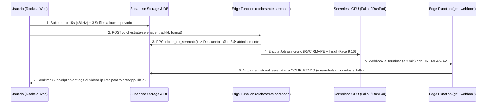

# ⚙️ Fase 3: Arquitectura Backend, Base de Datos (Supabase) y Orquestación GPU Serverless

Este documento detalla la implementación técnica de la **Fase 3** de **SerenatiAr**: el puente entre la interfaz de la Rockola y el clúster de inferencia de IA (**Fal.ai / RunPod / Replicate**) respaldado por **Supabase (PostgreSQL + Edge Functions + Storage)**.

---

## 1. Modelo Entidad-Relación en Supabase (`supabase/schema_ppp.sql`)

La base de datos está diseñada bajo principios **ACID** con políticas **RLS (Row Level Security)** para impedir que un usuario manipule su saldo de monedas desde el navegador:

1. **`public.mvp_leads`**: Captura de correos electrónicos de la "Puerta Falsa" y Onboarding con otorgamiento de 3 monedas de bienvenida.
2. **`public.paquetes_recarga`**: Matriz global de precios quemados por `tier_region` (`LATAM_COP`, `LATAM_MXN`, `NA_USD`, `EU_EUR`, `EMERGING_USD`) para los paquetes **Bronce (4🪙), Plata (10🪙) y Oro (25🪙)**.
3. **`public.catalogo_pistas_geo`**:Las 12 pistas originales georreferenciadas por continente (`LATAM`, `NA_UK`, `EUROPE`, `ASIA`) con rutas a sus stems (`instrumental` + `vocal_guide`) y plantilla de video 9:16.
4. **`public.billetera_usuarios`**: Billetera virtual con restricción `CHECK (saldo_monedas >= 0)` y control de uso de la muestra gratuita (`muestra_gratis_usada`).
5. **`public.transacciones_monedas`**: Libro mayor (*ledger* inmutable) que audita cada recarga vía webhook, cada consumo de GPU (`-1` Audio / `-3` Video) y cada reembolso automático si una GPU falla.
6. **`public.historial_serenatas`**: Cola de trabajos de inferencia con seguimiento de estado (`EN_COLA`, `PROCESANDO_RVC`, `MEZCLANDO_STEMS`, `PROCESANDO_FACESWAP`, `COMPLETADO`, `ERROR_REEMBOLSADO`).

---

## 2. Flujo de Orquestación Serverless GPU (< 180 Segundos)



---

## 3. Despliegue Rápido en tu Proyecto de Supabase

1. **Ejecutar el Esquema SQL:**
   * Abre el **SQL Editor** en tu panel de Supabase y pega el contenido íntegro de [`supabase/schema_ppp.sql`](./schema_ppp.sql).
2. **Crear el Bucket Privado de Biometría Temporal:**
   * Crea un bucket llamado `user-biometrics-temp` con regla de ciclo de vida (auto-borrado a las **24 horas**) para cumplir con la privacidad de voz y rostro del usuario.
3. **Desplegar las Edge Functions:**
   ```bash
   supabase functions deploy orchestrate-serenade
   supabase functions deploy gpu-webhook
   supabase secrets set FAL_KEY="tu_api_key_de_fal_ai"
   ```
